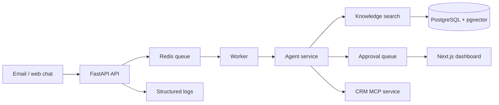

# Aria — AI Employee for Small Businesses

Aria is a tenant-aware operations assistant for small businesses. It receives inbound messages, answers from approved business knowledge, prepares bookings and replies, and routes risky actions to a human approval queue.

## What is included

- FastAPI backend with tenant-scoped businesses, conversations, knowledge documents, actions, and approvals
- Grounded keyword knowledge search with source citations and an explicit "I don't know" fallback
- Approval gate for external replies, booking changes, and other risky actions
- SQLite-backed local persistence with a PostgreSQL-compatible deployment seam
- Redis-compatible background worker boundary
- CRM MCP-style service exposing contacts, deals, notes, and logging
- Next.js dashboard for tenant-scoped approval review
- PostgreSQL/Redis Docker Compose setup
- Pytest tests, evaluation cases, and GitHub Actions CI

## Quick start

```powershell
docker compose up --build
```

The API is available at `http://localhost:8000`, API docs at `http://localhost:8000/docs`, and the dashboard at `http://localhost:3000`.

For local backend development:

```powershell
cd backend
python -m venv .venv
.\.venv\Scripts\Activate.ps1
pip install -r requirements.txt
pytest
uvicorn app.main:app --reload
```

The default local database is SQLite and is stored in `backend/aria.db` (ignored by Git). The local MVP uses SQLite persistence; PostgreSQL remains the Docker deployment seam for the next repository layer.

Run the evaluation cases from the repository root:

```powershell
python evals\run.py
```

The dashboard loads approvals using `NEXT_PUBLIC_API_URL` and the business ID entered on the page. Create a business through the API before loading its approvals.

## Safety model

Inbound content is untrusted data. It is never treated as an instruction. The backend only creates a pending approval for risky actions; sending messages or changing bookings is intentionally not implemented as an automatic side effect.

Every request that reads or writes business data requires the `X-Business-ID` header. Production authentication should replace this development tenant header with Clerk, Auth0, or Supabase Auth before deployment.

## Architecture



See [docs/architecture.md](docs/architecture.md) for phase boundaries and deployment notes.

## Development

- `pytest` — backend tests
- `python -m app.worker` — run the worker loop
- `npm run dev` — dashboard development server

Never commit `.env` files or credentials. Every new feature should include a test and preserve tenant isolation.
